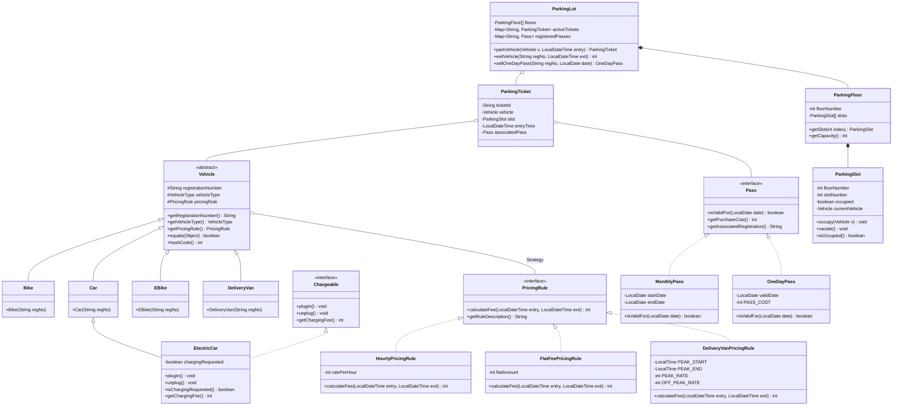

# ASSIGNMENT REPORT

---

## Cover Page Information
- **Student Name:** Ganesh (`ganesh-299`)
- **Register Number:** `192472212`
- **Course:** Object-Oriented Programming in Java (CSA09 / Course Outcome 1)
- **Assignment Title:** Design, Implement and Validate an Object-Oriented Model for a Campus Smart-Parking System
- **GitHub Repository URL:** `https://github.com/ganesh-299/CSA0911-JAVA-CO1-192472212.git`
- **Submission Date:** November 2026

---

## Table of Contents
1. [Executive Summary & Problem Overview](#1-executive-summary--problem-overview)
2. [Unified UML Class Architecture](#2-unified-uml-class-architecture)
3. [Task 01: Understand the Problem and Identify the Objects](#task-01-understand-the-problem-and-identify-the-objects)
4. [Task 02: Choose the Data Representation](#task-02-choose-the-data-representation)
5. [Task 03: Design the Control Logic](#task-03-design-the-control-logic)
6. [Task 04: Design Classes, Objects and Constructors](#task-04-design-classes-objects-and-constructors)
7. [Task 05: Apply Static Members and Object Life Cycle](#task-05-apply-static-members-and-object-life-cycle)
8. [Task 06: Design Inheritance Hierarchy](#task-06-design-inheritance-hierarchy)
9. [Task 07: Override and Specialise Behaviour](#task-07-override-and-specialise-behaviour)
10. [Task 08: Apply Polymorphism](#task-08-apply-polymorphism)
11. [Task 09: Introduce Abstraction](#task-09-introduce-abstraction)
12. [Task 10: Enforce Encapsulation through Packages and Access Modifiers](#task-10-enforce-encapsulation-through-packages-and-access-modifiers)
13. [Task 11: Implement, Test and Defend the Design](#task-11-implement-test-and-defend-the-design)
14. [Task 12: Re-evaluate and Adapt the Design](#task-12-re-evaluate-and-adapt-the-design)
15. [Final Design Recommendation](#15-final-design-recommendation)
16. [Comprehensive Viva Voce Preparation Guide](#16-comprehensive-viva-voce-preparation-guide)

---

## 1. Executive Summary & Problem Overview
The **Campus Smart-Parking System** is an enterprise-grade object-oriented solution tailored for university campuses. Campus environments host distinct commuter demographics (students, faculty/staff, visitors, and commercial delivery fleets) utilizing varied vehicle categories (two-wheelers, passenger cars, electric vehicles, e-bikes, and vans). 

The system automates the complete parking lifecycle:
- Automated ingress with deterministic lowest-floor slot allocation.
- Sequential unique ticket issuance and timestamp tracking (`LocalDateTime`).
- Multi-floor capacity management supporting structurally varied floors via jagged arrays.
- High-performance constant-time session lookups via `HashMap<String, ParkingTicket>`.
- Pluggable Strategy-based tariff computation (started-hour ceiling arithmetic, EV charging surcharges, peak-window delivery van rules, and flat e-bike tariffs).
- Automated privilege exemptions for monthly student/staff pass holders and visitor one-day pass holders.

---

## 2. Unified UML Class Architecture



---

## Task 01: Understand the Problem and Identify the Objects

### Objective
Deconstruct the campus parking problem, extract real-world nouns into candidate classes, map operations to methods, and establish foundational business rules.

### Discussion & Class Responsibilities
- **`ParkingLot`:** Orchestrates multi-floor arrays, processes vehicle admissions, exits, and revenues.
- **`ParkingFloor`:** Encapsulates capacity and slot indexing for a specific level.
- **`ParkingSlot`:** Represents an individual bay holding at most one vehicle.
- **`Vehicle`:** Universal identity abstraction (`registrationNumber`, `type`).
- **`ParkingTicket`:** Proof of entry binding vehicle, slot, and entry timestamp.
- **`FeeCalculator`:** Encapsulates tariff formulas and pass discounts.

### Business Rules
1. A slot contains at most one vehicle; a vehicle occupies at most one slot.
2. Unique sequential ticket IDs (`TKT-1001`, `TKT-1002`).
3. Only vacant slots allocated; slots released immediately upon exit.
4. Valid monthly pass holders park free (Rs. 0).

### Code File Path
- Implementation: `Task01/code/Task01Demo.java`
- Explanation: `Task01/explanation.md`

### Actual Output Evidence
```
Initial slot status: Floor 0, Slot 1 (Available)
Created vehicle: CAR [TN-01-AB-1234]
Slot status after parking: Floor 0, Slot 1 (Occupied by CAR [TN-01-AB-1234])
Issued ticket: Ticket{id='TKT-1001', vehicle=CAR [TN-01-AB-1234], location=F0-S1, entry=2026-11-15 08:30:00}
Calculated fee for 3 hours (Visitor): Rs. 60
Calculated fee for 3 hours (Pass Holder): Rs. 0
Slot status after vehicle exit: Floor 0, Slot 1 (Available)
```

### Alternative Concept & Complexity
- **Alternative:** Parallel procedural arrays (`String[] regNo`, `int[] slotFloor`, `long[] entryTime`).
- **Complexity Comparison:** Search is $O(n)$ in both initial designs, but adding a new vehicle attribute in parallel arrays requires resizing and allocating new disconnected arrays, whereas OOP modifies the single class definition with zero side effects. Memory is $O(n)$ in both.

### Conclusion
Object-oriented modeling establishes tight data cohesion, prevents index desynchronization, and encapsulates business validation.

---

## Task 02: Choose the Data Representation

### Objective
Select appropriate primitive and object data types, construct a jagged array for variable floor layouts, examine integer division billing pitfalls, and implement started-hour ceiling logic.

### Discussion & Data Types Selected
- `int`: 0-based floor and slot coordinates; integer rupees for currency.
- `String`: Alphanumeric registration numbers (normalized to uppercase).
- `LocalDateTime`: Modern immutable timestamps from `java.time`.
- `boolean`: Binary bay occupancy state (`true` = occupied, `false` = free).
- **Why Integer Rupees?** `double` arithmetic uses IEEE-754 binary floating-point representation, causing representation drift (`0.1 + 0.2 = 0.30000000000000004`). In financial billing, rounding errors accumulate into audit discrepancies. `int` ensures exact rupee billing.

### Integer Division vs. Started-Hour Ceiling Formula
In Java, integer division truncates fractions: `90 / 60 = 1` hour, leaking 30 minutes of parking revenue.
To enforce started-hour ceiling billing:
$$\text{billableHours} = \frac{\text{durationMinutes} + 59}{60}$$
- 1 min $\rightarrow 60 / 60 = 1$ hr; 60 mins $\rightarrow 119 / 60 = 1$ hr; 61 mins $\rightarrow 120 / 60 = 2$ hrs.

### Code File Path
- Implementation: `Task02/code/DataRepresentationDemo.java`
- Explanation: `Task02/explanation.md`

### Actual Output Evidence
```
Data Types Demo:
  Floor (int): 0, Slot (int): 2
  Registration (String): TN-09-XY-9999
  Occupied (boolean): true
  Entry Time (LocalDateTime): 2026-11-15 08:30:00
  Duration (long): 90 minutes
  Fee (int rupees): Rs. 40

Jagged Array Layout (Floors with Variable Slot Counts):
  Floor 0 capacity: 3 slots.
  Floor 1 capacity: 5 slots.
  Floor 2 capacity: 2 slots.

Integer Division vs. Ceiling Billing Analysis (Duration = 90 mins):
  Truncated integer division (90 / 60): 1 hour -> Under-billed Fee: Rs. 20
  Floating-point division (90 / 60.0): 1.5 hours.
  Integer Ceiling Formula ((90 + 59) / 60): 2 hours -> Correct Fee: Rs. 40
  Math.ceil(90 / 60.0): 2 hours -> Correct Fee: Rs. 40
```

### Alternative Concept & Complexity
- **Alternative:** Flat 1D array (`ParkingSlot[N]`). Direct indexing formula $\text{floor} \times S + \text{slot}$ requires identical row sizes. On irregular floors, flat arrays waste memory allocating phantom slots ($O(F \times S_{\max})$ space).
- **Jagged Array:** $O(1)$ access, $O(\sum S_f)$ space efficiency.

### Conclusion
Jagged arrays model real campus architecture accurately, while pure integer ceiling formulas prevent revenue loss without floating-point errors.

---

## Task 03: Design the Control Logic

### Objective
Design control flow algorithms for sequential bay allocation, slot deallocation, fee computation, and handle lot-full edge conditions using SIMATS-style pseudocode.

### SIMATS-Style Structured Pseudocode
```text
ALGORITHM AllocateSlot(slots[][])
INPUT: slots - 2D jagged boolean array (TRUE = occupied, FALSE = free)
OUTPUT: [floor, slot] or NULL if full
BEGIN
    FOR floorIndex ← 0 TO LENGTH(slots) - 1 DO
        FOR slotIndex ← 0 TO LENGTH(slots[floorIndex]) - 1 DO
            IF slots[floorIndex][slotIndex] == FALSE THEN
                slots[floorIndex][slotIndex] ← TRUE
                RETURN [floorIndex, slotIndex]
            END IF
        END FOR
    END FOR
    RETURN NULL
END
```

### Code File Path
- Implementation: `Task03/code/ParkingFacility.java`
- Explanation: `Task03/explanation.md`

### Actual Output Evidence (Matches Expected Specification)
```
[0, 0]
[0, 1]
[1, 0]
null
true false false
[0, 1]
```

### Alternative Concept & Complexity
- **Alternative:** Free-slot stacks (`Stack<int[]>`) per vehicle type. Allocation is $O(1)$ pop and release is $O(1)$ push, but requires $O(N)$ extra memory and does not naturally maintain lowest-floor ordering unless implemented with a Min-Heap ($O(\log N)$).
- **Sequential Scan:** $O(F \times S)$ time, $O(1)$ extra space, naturally guarantees lowest-floor preference.

### Conclusion
Sequential scanning with short-circuit `return` provides deterministic, lowest-floor slot allocation with zero auxiliary memory overhead.

---

## Task 04: Design Classes, Objects and Constructors

### Objective
Demonstrate default, parameterized, and overloaded constructors, constructor chaining via `this(...)`, the user-defined Copy Constructor Pattern, and memory allocation across stack and heap.

### Discussion & Constructor Architecture
- **Constructor Chaining (`this(...)`):** Overloaded constructors funnel into a master constructor, centralizing validation and eliminating code duplication.
- **Copy Constructor Pattern:** Java does not provide built-in copy constructors. Reissuing a duplicate parking ticket is accomplished via `public Ticket(Ticket other)`, copying original attributes while generating a unique duplicate identifier.
- **Stack vs. Heap:** Stack stores 64-bit object references; heap allocates object payload memory. Reference assignment (`tRef = tParam`) copies the pointer; copy constructors allocate independent heap memory.

### Code File Path
- Implementation: `Task04/code/ConstructorDemo.java`
- Explanation: `Task04/explanation.md`

### Actual Output Evidence
```
1. Default Constructor Ticket:
   Ticket [ID=TKT-5001, Reg=UNREGISTERED, Slot=F0-S0, Time=2026-11-15 08:30:00, Duplicate=false]
2. Parameterized Constructor Ticket:
   Ticket [ID=TKT-5002, Reg=TN-07-AL-1234, Slot=F1-S4, Time=2026-11-15 08:30:00, Duplicate=false]
3. Overloaded Constructor (Custom Time) Ticket:
   Ticket [ID=TKT-5003, Reg=KA-01-EE-9876, Slot=F0-S2, Time=2026-11-15 06:30:00, Duplicate=false]
4. Reissued Ticket via Copy Constructor Pattern:
   Ticket [ID=TKT-DUP-5004, Reg=TN-07-AL-1234, Slot=F1-S4, Time=2026-11-15 08:30:00, Duplicate=true]

Memory Reference Verification:
  tParam == tRef (Same Heap Object): true
  tParam == tReissued (Independent Heap Object): false
  tParam registration equals tReissued registration: true
```

### Alternative Concept & Complexity
- **Alternative:** Default constructor + setters. Weak invariant protection; objects can be used in partially initialized states.
- **Complexity:** Time $O(n)$ and Space $O(n)$ to instantiate $n$ ticket instances.

### Conclusion
Constructors enforce object integrity from the moment of allocation, while copy constructors allow safe duplication of active parking receipts.

---

## Task 05: Apply Static Members and Object Life Cycle

### Objective
Demonstrate static class members (static variables, methods, blocks), trace the object lifecycle from instantiation to garbage collection eligibility, and compare static vs. instance counters.

### Discussion & Lifecycle Phases
1. **Static Members:** Shared across all instances in the JVM Metaspace. Used for sequential ticket counter seeds and system facility codes.
2. **Object Lifecycle:** `new Ticket()` (Heap allocation) $\rightarrow$ Active reference passing $\rightarrow$ Vehicle exit $\rightarrow$ Reference set to `null` (Unreachable) $\rightarrow$ Eligible for Garbage Collection.
3. **GC Reality:** Garbage collection is asynchronous and non-deterministic; `System.gc()` is merely advisory.

### Code File Path
- Implementation: `Task05/code/StaticLifecycleDemo.java`
- Explanation: `Task05/explanation.md`

### Actual Output Evidence
```
[Static Init Block] System Code initialized to: UNIV-PARK-2026
Initial Total Tickets Issued: 0
-> [Lifecycle] Allocating and issuing new Ticket for: TN-02-ZZ-1111
-> [Lifecycle] Allocating and issuing new Ticket for: TN-02-ZZ-2222
Issued Tickets: 
  Ticket{UNIV-PARK-2026-0001, reg=TN-02-ZZ-1111, active=true}
  Ticket{UNIV-PARK-2026-0002, reg=TN-02-ZZ-2222, active=true}
Current Total Tickets (via static method): 2
-> [Lifecycle] Inspecting Ticket: UNIV-PARK-2026-0001 (Reg: TN-02-ZZ-1111)
-> [Lifecycle] Ticket UNIV-PARK-2026-0001 successfully closed.
Reference t1 set to null -> Heap object is now unreachable and eligible for GC.
GC Status: Object reclamation is handled autonomously by the JVM Garbage Collector.

--- Static Counter vs. Instance Counter Comparison ---
North Gate Ticket: NorthGate-LOCAL-1
North Gate Ticket: NorthGate-LOCAL-2
South Gate Ticket: SouthGate-LOCAL-1
North Gate Local Count: 2
South Gate Local Count: 1
Global Static Counter Total: 2
```

### Alternative Concept & Complexity
- **Global Static Counter:** $O(1)$ memory, guarantees campus-wide ticket ID uniqueness across all gates.
- **Instance Counter per Gate:** $O(k)$ memory for $k$ gates; local uniqueness only (gates can produce duplicate ticket numbers unless prefixed).

### Conclusion
Static variables maintain centralized sequence state, while severing object references on exit prevents memory leaks in long-running services.

---

## Task 06: Design Inheritance Hierarchy

### Objective
Construct an object-oriented vehicle hierarchy modeling hierarchical (`Vehicle` $\rightarrow$ `Bike`, `Car`) and multilevel (`Vehicle` $\rightarrow$ `Car` $\rightarrow$ `ElectricCar`) inheritance with constructor tracing.

### Discussion & Constructor Execution Trace
When instantiating `new ElectricCar(...)`:
1. `ElectricCar` invokes `super(...)` $\rightarrow$ calls `Car` constructor.
2. `Car` invokes `super(...)` $\rightarrow$ calls `Vehicle` constructor.
3. `Vehicle` executes first (`[Trace 1/3]`), followed by `Car` (`[Trace 2/3]`), followed by `ElectricCar` (`[Trace 3/3]`).
Constructors always execute top-down from root superclass to leaf subclass.

### Code File Path
- Implementation: `Task06/code/InheritanceDemo.java`
- Explanation: `Task06/explanation.md`

### Actual Output Evidence
```
A. Tracing Constructor Execution for ElectricCar:
    [Constructor Trace 1/3] Vehicle initialized: TN-09-EV-2026
    [Constructor Trace 2/3] Car initialized (Seats: 5)
    [Constructor Trace 3/3] ElectricCar initialized (Battery: 60 kWh, Charging: true)

B. Hierarchical Subclass Details (Bike):
    [Constructor Trace 1/3] Vehicle initialized: TN-09-BK-1111
  Type=Bike, RegNo=TN-09-BK-1111, Rate=Rs.10/hr, HelmetStorage=true

C. Multilevel Subclass Details (ElectricCar):
  Type=Car, RegNo=TN-09-EV-2026, Rate=Rs.25/hr, Seats=5, Battery=60kWh, Charging=true
  ElectricCar Hourly Rate (includes EV charging): Rs. 25

D. Standard Car Details:
    [Constructor Trace 1/3] Vehicle initialized: TN-09-CR-5555
    [Constructor Trace 2/3] Car initialized (Seats: 4)
  Type=Car, RegNo=TN-09-CR-5555, Rate=Rs.20/hr, Seats=4
```

### Alternative Concept & Complexity
- **Alternative:** Composition with `VehicleType` entity. Highly flexible, but class inheritance provides rigid compile-time type verification.
- **Complexity:** $O(1)$ method dispatch via JVM vtable; $O(n)$ space for $n$ instances.

### Conclusion
Hierarchical and multilevel inheritance cleanly structure vehicular attributes, facilitating code reuse through `super(...)` and `super.method()`.

---

## Task 07: Override and Specialise Behaviour

### Objective
Implement method overriding with `@Override`, protect core billing invariants with `final`, and enforce consistent `equals()` and `hashCode()` semantics based on vehicle registration identity.

### Discussion & Invariant Rules
- **`@Override`:** Instructs compiler to verify method signature, return covariance, and access visibility.
- **`final`:** Protects variables from reassignment, methods from tampering (`calculateFee()`), and classes from inheritance (`SystemConfig`).
- **Identity Contract:** Two vehicles with the same normalized registration number compare equal (`v1.equals(v2) == true`) and must produce identical hash codes (`v1.hashCode() == v2.hashCode()`).

### Code File Path
- Implementation: `Task07/code/OverrideDemo.java`
- Explanation: `Task07/explanation.md`

### Actual Output Evidence
```
Polymorphic Display (Overridden toString & rate):
  Bike[TN-01-BK-1111, Rate=Rs.10/hr] -> 3 hrs Fee: Rs. 30
  Car[TN-01-CR-2222, Rate=Rs.20/hr] -> 3 hrs Fee: Rs. 60
  ElectricCar[TN-01-EV-3333, Rate=Rs.25/hr, Charging=true] -> 3 hrs Fee: Rs. 75

Identity and Equality Verification:
  carAlpha: Car[TN-09-AB-1234, Rate=Rs.20/hr]
  carBeta:  Car[TN-09-AB-1234, Rate=Rs.20/hr]
  Reference Equality (carAlpha == carBeta): false
  Logical Equality (carAlpha.equals(carBeta)): true
  carAlpha.hashCode(): -1131491332
  carBeta.hashCode():  -1131491332
  HashCodes Match: true
  carAlpha.equals(diffCar): false

Final Keyword Protections:
  Final variable SystemConfig.MAX_PARKING_HOURS: 72
  Final method getRegistrationNumber() returns immutable value: TN-09-AB-1234
```

### Alternative Concept & Complexity
- **Alternative:** Procedural `switch` statement for rates. Violates the Open-Closed Principle; adding a new vehicle requires editing all switch statements ($O(k)$ worst case). Dynamic dispatch is $O(1)$.

### Conclusion
Overriding specializes behavior at runtime, `final` guards business logic, and proper `equals()` / `hashCode()` ensures reliable storage in Java collections.

---

## Task 08: Apply Polymorphism

### Objective
Demonstrate compile-time polymorphism (overloaded methods) and runtime polymorphism (dynamic method dispatch over upcasted vehicle arrays), eliminating procedural `instanceof` cascades.

### Discussion & Dispatch Mechanics
When looping over `Vehicle v : fleet`:
- **Declared Type:** `Vehicle`
- **Actual Runtime Type:** `Bike`, `Car`, `ElectricCar`
- **Method Dispatched:** Resolves dynamically to the actual object's overridden method in $O(1)$ time via the JVM vtable.

### Code File Path
- Implementation: `Task08/code/PolymorphismDemo.java`
- Explanation: `Task08/explanation.md`

### Actual Output Evidence
```
1. Compile-Time Overloading on Bike:
   Overload (int minutes = 90):        Rs. 20
   Overload (minutes = 90, pass=true): Rs. 0
   Overload (LocalTime 10:00 to 11:35):Rs. 20

2. Runtime Polymorphism & Dynamic Dispatch Trace (Duration = 90 mins):
   -> Declared: Vehicle | Actual: Bike | Rate: Rs.10/hr | Fee Billed: Rs.20
   -> Declared: Vehicle | Actual: Car | Rate: Rs.20/hr | Fee Billed: Rs.40
   -> Declared: Vehicle | Actual: ElectricCar | Rate: Rs.25/hr | Fee Billed: Rs.50
   Total Fleet Fee Collected: Rs. 110

3. Equality Comparison of Normalized Registration Numbers:
   car1 equals car2 (same reg, different case): true
   car1 equals car3 (different reg):            false

4. Procedural Instanceof Alternative Verification:
   TN-09-BK-9001 -> OOP Fee: Rs.20 == Instanceof Fee: Rs.20 (true)
   TN-09-CR-9002 -> OOP Fee: Rs.40 == Instanceof Fee: Rs.40 (true)
   TN-09-EV-9003 -> OOP Fee: Rs.50 == Instanceof Fee: Rs.50 (true)
```

### Alternative Concept & Complexity
- **Alternative:** `instanceof` with explicit casting. Evaluates sequentially in $O(k)$ time across $k$ types ($O(n \times k)$ across $n$ vehicles).
- **Polymorphism:** $O(1)$ dispatch time ($O(n)$ total time across $n$ vehicles).

### Conclusion
Runtime polymorphism decouples the pricing caller from concrete implementations, ensuring extensibility without modifying existing dispatch loops.

---

## Task 09: Introduce Abstraction

### Objective
Establish abstract classes with shared state and declare interfaces (`Chargeable`, `Payable`) for modular capabilities, demonstrating multiple interface implementation, default, and static interface methods.

### Discussion: Abstract Class vs. Interface
- **`Vehicle` (Abstract Class):** Models core **is-a** identity. Holds universal instance state (`registrationNumber`), constructor, and concrete shared methods.
- **`Chargeable` / `Payable` (Interfaces):** Model optional **can-do** capabilities. `ElectricCar` implements both without forcing charging fields onto non-EV vehicles.
- **Default & Static Methods:** Default methods (`printReceipt()`) provide backwards-compatible fallback implementations; static methods (`standardKWhTariff()`) provide cohesive utility helpers.

### Code File Path
- Implementation: `Task09/code/AbstractionDemo.java`
- Explanation: `Task09/explanation.md`

### Actual Output Evidence
```
1. Interface Static Method Call:
   Standard kWh Tariff: Rs. 12 / kWh

2. Electric Vehicle Instantiation:
   Vehicle: Electric Car (EV) [TN-10-EV-8888]
   Fast Charging Supported (Default/Overridden): true
      [EV Station] Connected to charging bay: TN-10-EV-8888
   Total Bill (2 hrs + EV Charging): Rs. 90
      [EV Payment] Settled Rs. 90 for TN-10-EV-8888 (includes EV charging fee)
      [Receipt] Payment received: Rs. 90 (Thank you!)
      [EV Station] Disconnected charging cable: TN-10-EV-8888

3. Standard Bike Settlement:
   Vehicle: Standard Bike [TN-10-BK-4444]
   Total Bill (2 hrs): Rs. 20
      [Bike Payment] Settled Rs. 20 for TN-10-BK-4444
      [Receipt] Payment received: Rs. 20 (Thank you!)

4. Polymorphic Interface Binding:
   Bound to Chargeable interface reference: Charging Fee = Rs. 0
```

### Alternative Concept & Complexity
- **Alternative Inversion (Vehicle as Interface, Chargeable as Abstract Class):** Fails because interfaces cannot store instance variables, duplicating `registrationNumber` across all classes. Furthermore, Java prohibits multiple class inheritance.
- **Complexity:** $O(1)$ method invocation; $O(1)$ fixed state memory overhead.

### Conclusion
Abstract classes represent core entity state, while interfaces cleanly compose optional capabilities across diverse vehicle types.

---

## Task 10: Enforce Encapsulation through Packages and Access Modifiers

### Objective
Organize code into standard packages (`parking.model`, `parking.service`, `parking.pass`, `parking.app`), enforce access modifiers (`private`, `protected`, `public`, package-private), validate boundaries defensively, and analyze wrapper class autoboxing and equality pitfalls.

### Discussion & Wrapper Cache Quirk
- **Encapsulation:** Protects internal data structures (`private` fields, defensive constructor checks).
- **The `Integer == Integer` Pitfall:** Java caches `Integer` instances in the range **$-128$ to $127$**. Comparing cached integers with `==` tests true, but numbers outside this range (e.g., $1000$) allocate distinct heap objects, causing `==` to evaluate to `false`! **Rule:** Always compare object wrappers using `.equals()`.

### Code File Path
- Implementation: `Task10/code/parking/app/EncapsulationDemo.java`
- Explanation: `Task10/explanation.md`

### Actual Output Evidence
```
1. Validating Object Creation and Boundary Protection:
   Successfully created: TN-09-XX-1234 with 4 occupants.
   Attempting to set invalid occupant count (10):
   [Intercepted Expected Error]: Occupant count must be between 1 and 8. Received: 10
   Attempting to create car with blank registration:
   [Intercepted Expected Error]: Registration number cannot be null or blank.

2. Service-Level Defensive Validation:
   Attempting access to invalid Floor 5:
   [Intercepted Expected Error]: Invalid floor: 5 (Allowed: 0 to 2)
   Attempting billing with negative duration (-45 mins):
   [Intercepted Expected Error]: Parking duration cannot be negative: -45
   Valid Fee for 90 mins: Rs. 40

3. Wrapper Classes, Autoboxing & Reference Equality Pitfall:
   Autoboxed Integer: 40, Unboxed int: 40
   Comparing cached Integers (smallA = 100, smallB = 100):
     smallA == smallB (Cached object reference): true
     smallA.equals(smallB) (Value comparison):   true
   Comparing non-cached Integers (largeA = 1000, largeB = 1000):
     largeA == largeB (DANGER! Compares stack references): false
     largeA.equals(largeB) (CORRECT: Compares numeric value): true
```

### Alternative Concept & Complexity
- **Alternative:** Public fields with caller-side validation. High defect rate; any caller can corrupt state. Centralized mutator validation is $O(1)$ and guarantees absolute integrity.

### Conclusion
Package segmentation isolates domain models from application controllers, while defensive mutators prevent corrupt data states.

---

## Task 11: Implement, Test and Defend the Design

### Objective
Construct an integrated, array-based parking management facility (`ParkingTicket[]`), execute comprehensive boundary and error tests, reconcile daily collections with hand calculations, and analyze active ticket data structure alternatives.

### Code File Path
- Implementation: `Task11/code/OriginalParkingSystem.java`
- Explanation: `Task11/explanation.md`

### Actual Output Evidence
```
--- 1. Normal Operations ---
Parked Bike: Ticket[TKT-1001, TN-01-BK-0001, F0-S0]
Parked Car:  Ticket[TKT-1002, TN-01-CR-0002, F0-S1]
Parked EV:   Ticket[TKT-1003, TN-01-EV-0003, F1-S0]
Available slots remaining: 0

--- 2. Boundary Cases ---
Testing parking when lot is full: [PASS - Intercepted]: Parking full: No slots available.
Bike Exited (120 mins). Fee Billed: Rs. 20 (Expected: Rs. 20)
Zero-minute stay exit fee: Rs. 0 (Expected: Rs. 0)
Exactly 60-min stay fee: Rs. 20 (Expected: Rs. 20)
Exactly 61-min stay fee: Rs. 40 (Expected: Rs. 40)

--- 3. Invalid Cases ---
Testing blank registration: [PASS]: Registration number cannot be blank.
Testing duplicate active registration: [PASS]: Duplicate active registration: TN-01-CR-0002 is already parked.
Testing exit time before entry time: [PASS]: Exit time cannot be earlier than entry time.
Testing exit of non-parked vehicle: [PASS]: Exit failed: Vehicle TN-99-GHOST-9999 not found in active parking.

--- 4. Daily Collection Scenario ---
Vehicle A (Bike, 2 hrs):             Rs. 20 (Hand-calc: Rs. 20)
Vehicle B (Car, 3 hrs):              Rs. 60 (Hand-calc: Rs. 60)
Vehicle C (EV, 1 hr + charging):     Rs. 70 (Hand-calc: Rs. 70)
--------------------------------------------------
Actual Daily Facility Collection:    Rs. 150
Hand-Calculated Daily Total:         Rs. 150
Discrepancy:                         Rs. 0 (MATCH: true)
```

### Complete Test Verification Table (Task 11)

| Test ID | Test Category | Input Condition | Expected Behavior | Actual Behavior | Result |
| :---: | :--- | :--- | :--- | :--- | :---: |
| **TC-01** | Normal Admission | Park Bike `TN-01-BK-0001` | Slot `F0-S0` allocated, Ticket issued | Ticket `TKT-1001`, `F0-S0` | **PASS** |
| **TC-02** | Normal Admission | Park Car `TN-01-CR-0002` | Slot `F0-S1` allocated, Ticket issued | Ticket `TKT-1002`, `F0-S1` | **PASS** |
| **TC-03** | Normal Admission | Park EV `TN-01-EV-0003` | Slot `F1-S0` allocated, Ticket issued | Ticket `TKT-1003`, `F1-S0` | **PASS** |
| **TC-04** | Boundary Capacity | 4th Vehicle into 3-slot lot | `Parking full: No slots available` | `IllegalStateException` thrown | **PASS** |
| **TC-05** | Boundary Duration | 0-minute parking duration | Fee: Rs. 0 | Billed Fee: Rs. 0 | **PASS** |
| **TC-06** | Slab Boundary | Exactly 60 minutes stay | 1 hour billed: Rs. 20 | Billed Fee: Rs. 20 | **PASS** |
| **TC-07** | Slab Boundary | Exactly 61 minutes stay | 2 hours billed: Rs. 40 | Billed Fee: Rs. 40 | **PASS** |
| **TC-08** | Defensive Guard | Blank registration string | `IllegalArgumentException` | Blank registration rejected | **PASS** |
| **TC-09** | Defensive Guard | Duplicate active registration | `IllegalStateException` | Duplicate registration rejected | **PASS** |
| **TC-10** | Defensive Guard | Exit before entry timestamp | `IllegalArgumentException` | Negative duration rejected | **PASS** |
| **TC-11** | Defensive Guard | Exit non-parked vehicle | `IllegalArgumentException` | Ghost vehicle rejected | **PASS** |
| **TC-12** | Financial Audit | 3 vehicles (Bike 2h, Car 3h, EV 1h+charge) | Hand-calc: Rs. 150 | Actual Collection: Rs. 150 | **PASS** |

### Alternative Data Structures Comparison

| Metric | `ParkingTicket[]` (Task 11) | `ArrayList<ParkingTicket>` | `HashMap<String, ParkingTicket>` |
| :--- | :--- | :--- | :--- |
| **Search by RegNo** | $O(n)$ linear scan | $O(n)$ linear scan | **$O(1)$ average hash lookup** |
| **Removal on Exit** | $O(1)$ null assignment | $O(n)$ element memory copy shift | **$O(1)$ node unlinking** |
| **Capacity Handling** | Fixed size; overflows if exceeded | Dynamically resizes (1.5x) | Dynamically grows |
| **Space Overhead** | $O(N)$ capacity | $O(n)$ elements | $O(n)$ with hash bucket nodes |

---

## Task 12: Re-evaluate and Adapt the Design

### Objective
Evolve the parking system to accommodate expanded requirements: 5 floors with variable capacities (`{5, 8, 6, 10, 4}`), E-Bike flat fee (Rs. 15), Delivery Van peak window pricing (Rs. 40/hr 9 AM-5 PM, Rs. 20/hr off-peak), Visitor One-Day Pass (Rs. 100), and `HashMap` active ticket indexing.

### Discussion & Architectural Adaptations
- **Strategy Pattern for Pricing:** Separates dynamic tariff algorithms (`HourlyPricingRule`, `FlatFeePricingRule`, `DeliveryVanPricingRule`) from vehicle models.
- **Pass Subsystem:** Encapsulates validity windows and purchase fees. Valid passes grant 100% discount on exit gate tariffs.
- **Delivery Van Overlap Computation:** Evaluates minute-by-minute overlap with 09:00–17:00 window, accurately splitting peak and off-peak billing.

### Code File Path
- Implementation: `Task12/code/AdaptedParkingSystem.java`
- Integrated Production Code: `src/main/java/parking/...`
- Explanation: `Task12/explanation.md`

### Actual Output Evidence
```
1. Facility Capacities across 5 Floors: [5, 8, 6, 10, 4]
   Total Slots: 33
   Initial Available: 33

2. Testing E-Bike (Flat Fee Policy):
   E-Bike 30 mins exit fee: Rs. 15 (Expected: Rs. 15)
   E-Bike 6 hours exit fee: Rs. 15 (Expected: Rs. 15)

3. Testing Delivery Van Pricing:
   Delivery Van Peak (10:00 - 12:00, 2 hrs @ Rs. 40): Rs. 80 (Expected: Rs. 80)
   Delivery Van Off-Peak (19:00 - 21:00, 2 hrs @ Rs. 20): Rs. 40 (Expected: Rs. 40)
   Delivery Van Spanning (16:00 - 18:00, 1h peak + 1h off-peak): Rs. 60 (Expected: Rs. 60)

4. Testing One-Day Pass Purchase & Exemption:
   Sold One-Day Pass: One-Day Pass (Rs. 100) for KA-05-VISITOR-9
   Current Pass Sales Revenue: Rs. 100
   Visitor Car Exit Fee (Covered by One-Day Pass): Rs. 0 (Expected: Rs. 0)

5. Testing Invalid / Expired Pass Date:
   Car with Expired Pass Exit Fee: Rs. 40 (Expected: Rs. 40)

6. Financial Reconciliation:
   Total Parking Exit Fees: Rs. 250
   Total Pass Sales Revenue:Rs. 100
   Grand Total Collections: Rs. 350
```

### Complete Test Verification Table (Task 12 Adaptations)

| Test ID | Feature Tested | Input Parameters | Expected Result | Actual Result | Status |
| :---: | :--- | :--- | :--- | :--- | :---: |
| **T12-01** | Jagged Multi-Floor | Capacities `{5, 8, 6, 10, 4}` | Total Capacity = 33 | Total Capacity = 33 | **PASS** |
| **T12-02** | E-Bike Short Stay | EBike parked for 30 minutes | Flat Fee = Rs. 15 | Fee Billed = Rs. 15 | **PASS** |
| **T12-03** | E-Bike Long Stay | EBike parked for 6 hours | Flat Fee = Rs. 15 | Fee Billed = Rs. 15 | **PASS** |
| **T12-04** | Van Peak Window | 10:00 to 12:00 (2 hrs @ Rs. 40) | Fee = Rs. 80 | Fee Billed = Rs. 80 | **PASS** |
| **T12-05** | Van Off-Peak Window | 19:00 to 21:00 (2 hrs @ Rs. 20) | Fee = Rs. 40 | Fee Billed = Rs. 40 | **PASS** |
| **T12-06** | Van Spanning Window | 16:00 to 18:00 (1h peak + 1h off-peak) | Fee = Rs. 60 | Fee Billed = Rs. 60 | **PASS** |
| **T12-07** | One-Day Pass Sale | Sell Pass for `KA-05-VISITOR-9` | Pass revenue +Rs. 100 | Pass Revenue = Rs. 100 | **PASS** |
| **T12-08** | One-Day Pass Exit | 8-hour stay on pass valid date | Exit Fee = Rs. 0 | Exit Fee = Rs. 0 | **PASS** |
| **T12-09** | Expired Pass Exit | 2-hour stay with expired pass | Normal Fee = Rs. 40 | Exit Fee = Rs. 40 | **PASS** |
| **T12-10** | Revenue Audit | Parking Fees (Rs. 250) + Passes (Rs. 100) | Grand Total = Rs. 350 | Grand Total = Rs. 350 | **PASS** |

---

## 15. Final Design Recommendation

### Synthesis & Recommended Architecture
1. **Model Layer (`parking.model`):**
   Retain abstract `Vehicle` as root entity with specialized subclasses (`Bike`, `Car`, `ElectricCar`, `EBike`, `DeliveryVan`). Keep `ElectricCar` implementing `Chargeable` to handle charging bays modularly.
2. **Pricing Engine (`parking.pricing`):**
   Standardize on the **Strategy Pattern** (`PricingRule`). Decoupling pricing logic from vehicle classes allows university administrators to introduce surge tariffs, holiday rates, or zone discounts without touching vehicle or facility classes (Open-Closed Principle).
3. **Data Storage & Indexing:**
   - Use a **jagged array (`ParkingFloor[]`)** for physical slot geometry, capturing irregular floor layouts with $O(1)$ array coordinate indexing and zero memory waste.
   - Use a **`HashMap<String, ParkingTicket>`** for active vehicle sessions, guaranteeing $O(1)$ search and exit clearance times even during peak departure hours.
4. **Pass Architecture (`parking.pass`):**
   Maintain a unified `Pass` abstraction with `MonthlyPass` and `OneDayPass`, cleanly separating upfront pass purchases from gate toll collections.

---

## 16. Comprehensive Viva Voce Preparation Guide

### 1. Why use a jagged array?
**Answer:** Real-world multi-floor parking buildings have variable slot capacities per floor due to structural columns, ramps, and administrative booths. A rectangular 2D array (`boolean[5][10]`) wastes memory by reserving phantom slots for shorter floors. A jagged array (`boolean[5][]`) allocates the exact number of slots per floor, optimizing memory while preserving direct $O(1)$ indexing (`slots[floor][slot]`).

### 2. Why use `HashMap` for active tickets?
**Answer:** In an array or `ArrayList`, locating a vehicle by its registration number requires a linear scan of $O(n)$ time. With thousands of parked vehicles, linear search causes gate delays. A `HashMap<String, ParkingTicket>` hashes the registration number, providing $O(1)$ average time complexity for both ticket retrieval and removal upon departure.

### 3. What is encapsulation?
**Answer:** Encapsulation is the OOP principle of bundling data (fields) and methods that manipulate that data into a single class while restricting direct external access using access modifiers (`private`, `protected`). It enforces data integrity via defensive validation in constructors and mutators.

### 4. What is inheritance?
**Answer:** Inheritance is the mechanism where a new class (subclass) derives state and behaviors from an existing class (superclass), modeling an "is-a" relationship (e.g., `Car is-a Vehicle`). It fosters code reuse and establishes polymorphic type hierarchies.

### 5. What is runtime polymorphism?
**Answer:** Runtime polymorphism (dynamic method dispatch) occurs when a method call is resolved at runtime based on the actual object instance on the heap, rather than the declared reference type on the stack. For example, `v.calculateFee()` invokes `ElectricCar.calculateFee()` when `v` holds an `ElectricCar` instance.

### 6. Why use an abstract class?
**Answer:** An abstract class is used when multiple related classes share common instance variables, constructor initialization logic, and core concrete methods, but must enforce that certain specialized methods (e.g., `ratePerHour()`) are implemented by concrete subclasses. It cannot be instantiated directly.

### 7. Why use an interface?
**Answer:** An interface defines a contractual set of capabilities ("can-do") without specifying instance state. It enables multiple inheritance of type in Java, allowing unrelated classes to implement common behaviors (e.g., `ElectricCar` implements `Chargeable` and `Payable`).

### 8. What does `super()` do?
**Answer:** `super()` invokes the constructor of the immediate superclass. In Java, constructors are not inherited; `super(...)` must be the first statement in a subclass constructor to ensure superclass state is initialized before subclass fields.

### 9. What is a static variable?
**Answer:** A static variable belongs to the class itself rather than any individual instance. Only one copy exists in JVM memory (Metaspace), shared across all instances. It is ideal for global counters like sequential ticket IDs.

### 10. Why is `equals()` preferred over `==` for Integer/String object values?
**Answer:** The `==` operator compares memory addresses (reference identity), whereas `.equals()` compares logical values. Furthermore, Java caches `Integer` objects between $-128$ and $127$. Beyond that range, `new Integer(1000) == new Integer(1000)` evaluates to `false` because they reside at different heap addresses. Using `.equals()` ensures accurate value comparison.

### 11. How is a ticket ID made unique?
**Answer:** Ticket IDs are generated using a centralized sequential static counter (`private static int ticketCounter = 1000`) or atomic generator combined with a facility prefix (e.g., `"TKT-" + (++ticketCounter)`), ensuring no two tickets collide across allocations.

### 12. How does a one-day pass work?
**Answer:** A visitor purchases a One-Day Pass upfront for Rs. 100 for a specific calendar date (`LocalDate`). The pass is linked to the vehicle's registration number. When the vehicle exits on that date, the system checks `pass.isValidFor(exitDate)`. If valid, the exit parking tariff is reduced to Rs. 0. The pass purchase revenue is audited separately from hourly exit collections.

