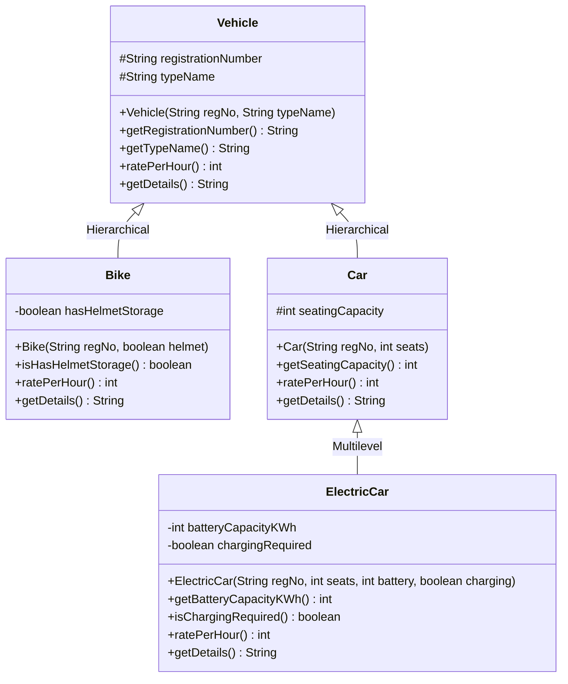

# Task 06: Design Inheritance Hierarchy

## 1. Inheritance Hierarchy Overview

In the Campus Smart-Parking System, inheritance models the "is-a" relationship between general transport vehicles and specialized vehicular types.



### Types of Inheritance Used:
1. **Hierarchical Inheritance:**
   Both `Bike` and `Car` directly extend the base class `Vehicle`. They inherit the universal properties `registrationNumber` and `typeName` while providing their own specializations.
2. **Multilevel Inheritance:**
   `ElectricCar` extends `Car`, which in turn extends `Vehicle` (`Vehicle` $\rightarrow$ `Car` $\rightarrow$ `ElectricCar`). An `ElectricCar` is a specialized `Car` with passenger seating, plus an electric powertrain and charging requirements.

---

## 2. Inherited vs. Subclass-Specific Fields

| Class | Inherited Fields | Subclass-Specific Fields | Purpose |
| :--- | :--- | :--- | :--- |
| **`Vehicle`** | *(None - Root)* | `registrationNumber`, `typeName` | Universal vehicular identity. |
| **`Bike`** | `registrationNumber`, `typeName` | `hasHelmetStorage` | Two-wheeler parking logistics. |
| **`Car`** | `registrationNumber`, `typeName` | `seatingCapacity` | Standard four-wheeler capacity. |
| **`ElectricCar`** | `registrationNumber`, `typeName`, `seatingCapacity` | `batteryCapacityKWh`, `chargingRequired` | Electric vehicle battery monitoring & charging surcharges. |

---

## 3. Use of `super(...)`, `super.field`, and `super.method()`
- **`super(...)` Constructor Invocation:**
  A subclass does not inherit the constructors of its superclass. Calling `super(registrationNumber, "Bike")` as the very first line of the `Bike` constructor delegates base initialization up the inheritance chain.
- **`super.method()` Method Reuse:**
  In `ElectricCar.ratePerHour()`, calling `super.ratePerHour()` invokes the parent `Car` rate calculation (Rs. 20/hr) before adding the EV-specific charging surcharge (+Rs. 5/hr). This eliminates duplicate hard-coding.
- **`super.getDetails()` String Formatting:**
  Allows subclasses to decorate and extend the parent's string description rather than rewriting all attributes.

---

## 4. Tracing Constructor Execution for `ElectricCar`
When executing `new ElectricCar("TN-09-EV-2026", 5, 60, true)`:
1. The `ElectricCar` constructor is called on the stack frame.
2. Its first statement `super(registrationNumber, seatingCapacity)` invokes the `Car` constructor.
3. The `Car` constructor's first statement `super(registrationNumber, "Car")` invokes the `Vehicle` constructor.
4. `Object` constructor completes $\rightarrow$ `Vehicle` initializes `registrationNumber` and `typeName` (`[Trace 1/3]`).
5. Control unwinds to `Car`, initializing `seatingCapacity` (`[Trace 2/3]`).
6. Control unwinds to `ElectricCar`, initializing `batteryCapacityKWh` and `chargingRequired` (`[Trace 3/3]`).
**Rule:** Subclass constructors always execute from the top of the hierarchy (root superclass) downward to the leaf class.

---

## 5. Alternative Approach: Composition with `VehicleType` Object

Instead of class inheritance, an alternative design is **Composition**:
```java
public class Vehicle {
    private String registrationNumber;
    private VehicleTypeInfo typeInfo; // Composed object
}

public class VehicleTypeInfo {
    private String category; // "BIKE", "CAR", "EV"
    private int baseRate;
    private boolean allowsCharging;
}
```

### Comparison: Inheritance vs. Composition

| Evaluation Metric | Class Inheritance (`extends`) | Object Composition (`has-a`) |
| :--- | :--- | :--- |
| **Adding a New Vehicle Type** | Requires writing a new subclass (e.g., `class EBike extends Vehicle`). Highly structured, type-safe. | Flexible: Can create new types at runtime by instantiating new `VehicleTypeInfo` records or loading from JSON/database without recompilation. |
| **Fee Calculation** | Dynamic dispatch resolves `ratePerHour()` in $O(1)$ time via the JVM vtable. | Delegation to `typeInfo.getBaseRate()` in $O(1)$ time. |
| **Total Memory Complexity** | $O(n)$ space for $n$ vehicles. Memory overhead is strictly $O(1)$ per vehicle instance. | $O(n)$ space for $n$ vehicles, with shared reference to flyweight `VehicleTypeInfo` objects ($O(1)$ type metadata). |
| **Coupling** | Tightly coupled: Changes in `Vehicle` affect all subclasses. | Loosely coupled: Type definitions are independent of vehicle instances. |

---

## 6. Conclusion
The inheritance hierarchy (`Vehicle` $\rightarrow$ `Car` $\rightarrow$ `ElectricCar` and `Vehicle` $\rightarrow$ `Bike`) provides a natural, type-safe representation of real-world vehicles. It ensures code reuse via `super(...)` and constructor chaining while cleanly isolating vehicle-specific attributes.

