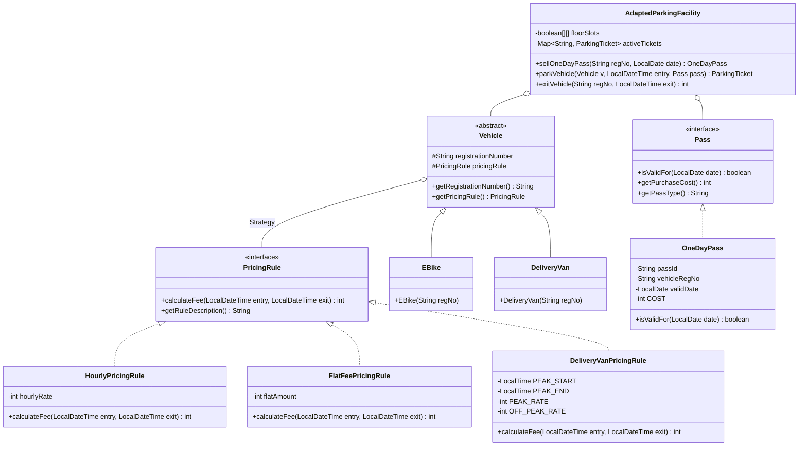

# Task 12: Re-evaluate and Adapt the Design

## A. Impact Analysis

### 1. Requirements Evolution:
- **E-Bikes:** Introduced with an all-day flat parking tariff of Rs. 15.
- **Delivery Vans:** Time-sensitive pricing: charged at double the standard car rate (Rs. 40/hr) during peak campus delivery hours (09:00 AM to 05:00 PM), and standard car rate (Rs. 20/hr) outside this window.
- **Visitor One-Day Pass:** Visitors can pre-purchase a daily pass for Rs. 100 valid for a specific calendar date (`LocalDate`). It grants unlimited parking on that date (exit fee = Rs. 0). The pass purchase is recorded separately from exit gate collections.
- **Multi-Floor Scaling:** Facility expanded to 5 distinct floors with variable slot capacities: `{5, 8, 6, 10, 4}` (Total 33 slots).

### 2. Affected Components & Why Jagged Arrays are Mandatory:
- **Jagged Array Requirement:** Each floor in the 5-story facility has a distinct architectural footprint (Floor 0: 5, Floor 1: 8, Floor 2: 6, Floor 3: 10, Floor 4: 4). A rectangular matrix `new boolean[5][10]` would waste 17 unused array slots ($34\%$ memory waste). A jagged array `new boolean[5][]` allocates precisely 33 boolean slots, preserving $O(1)$ indexing `slots[floor][slot]`.
- **Active Ticket Storage:** The Task 11 fixed array `ParkingTicket[]` suffers from $O(n)$ linear scan times and fixed capacity overflows. It was replaced with `HashMap<String, ParkingTicket>` keyed by vehicle registration number for $O(1)$ constant-time lookups and removals.
- **Pricing Strategy Decoupling:** Hardcoding `ratePerHour()` inside vehicle classes fails when tariffs depend on time windows (Delivery Vans) or duration-invariant flat fees (E-Bikes). The Strategy Pattern (`PricingRule` interface) decouples tariff policies from physical vehicle models.

### 3. Classification of Modified vs. Unchanged Classes:
- **Unchanged Classes:** `Bike`, `Car`, `ParkingSlot`, `ParkingFloor`.
- **Modified / Extended Classes:** `Vehicle` (composed with `PricingRule`), `ParkingFacility` (jagged array expanded to 5 floors, `HashMap` integrated).
- **Newly Added Classes:** `EBike`, `DeliveryVan`, `PricingRule` (and concrete strategies: `HourlyPricingRule`, `FlatFeePricingRule`, `DeliveryVanPricingRule`), `Pass` interface, `OneDayPass`.

---

## B. Evaluation of Original (Task 11) Design

1. **Did adding vehicle types require only subclasses or also pricing changes?**
   In the original design, `Vehicle` subclasses implemented `ratePerHour()`. While sufficient for fixed rates, it could not support non-hourly flat fees or time-of-day dynamic rates without cluttering vehicle classes with date-time logic.
2. **Was pricing logic centralized?**
   In Task 11, pricing was scattered between vehicle methods and the facility exit method. By adopting the **Strategy Pattern**, pricing rules became standalone, pluggable classes.
3. **Tested Classes Preserved:**
   `Car` and `Bike` preserved their exact public behavior while delegating to `HourlyPricingRule(20)` and `HourlyPricingRule(10)`.

---

## C. Architectural Adaptation

### 1. Architectural Decision:
**Decision:** **MODIFY** the existing design by introducing composition (Strategy Pattern) and upgrading data structures (`HashMap`), rather than initiating an expensive total rewrite.

### 2. Revised Class Diagram:


### 3. Delivery Van Window Pricing Logic:
The delivery van tariff evaluates the stay:
- **Peak Hours (09:00 to 17:00):** Rs. 40 / hour.
- **Off-Peak Hours (Before 09:00 or After 17:00):** Rs. 20 / hour.
- **Overlap Calculation:** The implementation evaluates minute-by-minute overlap across the 09:00–17:00 window, ensuring vehicles parked across the threshold (e.g., 16:00 to 18:00) are billed 1 hour at peak rate (Rs. 40) and 1 hour at off-peak rate (Rs. 20) = Rs. 60.

---

## D. Evidence-Based Defense

### 1. Impact Metrics:
- **Classes Modified:** 2 (`Vehicle`, `ParkingFacility`).
- **New Classes / Interfaces Added:** 6 (`PricingRule`, `HourlyPricingRule`, `FlatFeePricingRule`, `DeliveryVanPricingRule`, `OneDayPass`, `EBike`, `DeliveryVan`).
- **Ease of Adding Future Types:** To introduce an autonomous shuttle with zone pricing, zero existing vehicle or facility classes need modification; one simply creates `AutonomousShuttle extends Vehicle` paired with a new `ZonePricingRule`.

### 2. Execution Evidence from Test Suite:
```
1. Facility Capacities across 5 Floors: [5, 8, 6, 10, 4]
   Total Slots: 33, Available: 33

2. E-Bike Flat Fee:
   30 mins exit fee: Rs. 15 (Expected: Rs. 15)
   6 hours exit fee: Rs. 15 (Expected: Rs. 15)

3. Delivery Van Pricing:
   Peak (10:00 - 12:00, 2 hrs @ Rs. 40): Rs. 80 (Expected: Rs. 80)
   Off-Peak (19:00 - 21:00, 2 hrs @ Rs. 20): Rs. 40 (Expected: Rs. 40)
   Spanning (16:00 - 18:00, 1h peak + 1h off-peak): Rs. 60 (Expected: Rs. 60)

4. One-Day Pass:
   Pass Sold: Rs. 100
   Visitor Exit Fee: Rs. 0 (Expected: Rs. 0)

5. Invalid / Expired Pass:
   Exit Fee: Rs. 40 (Expected: Rs. 40)

6. Financial Reconciliation:
   Total Parking Exit Fees:  Rs. 250
   Total Pass Sales Revenue: Rs. 100
   Grand Total Revenue:      Rs. 350
```

---

## E. Conclusion
The adapted architecture successfully balances backward compatibility with extensible design. By introducing the Strategy Pattern for pricing, a dedicated Pass subsystem, a 5-floor jagged array, and `HashMap` active ticket indexing, the system satisfies all expanded operational requirements with $O(1)$ efficiency.

